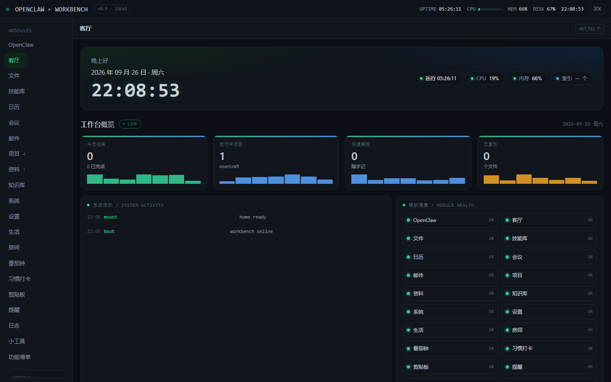
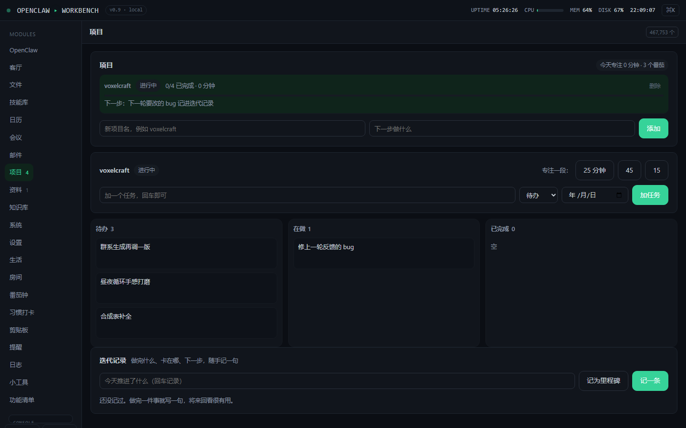
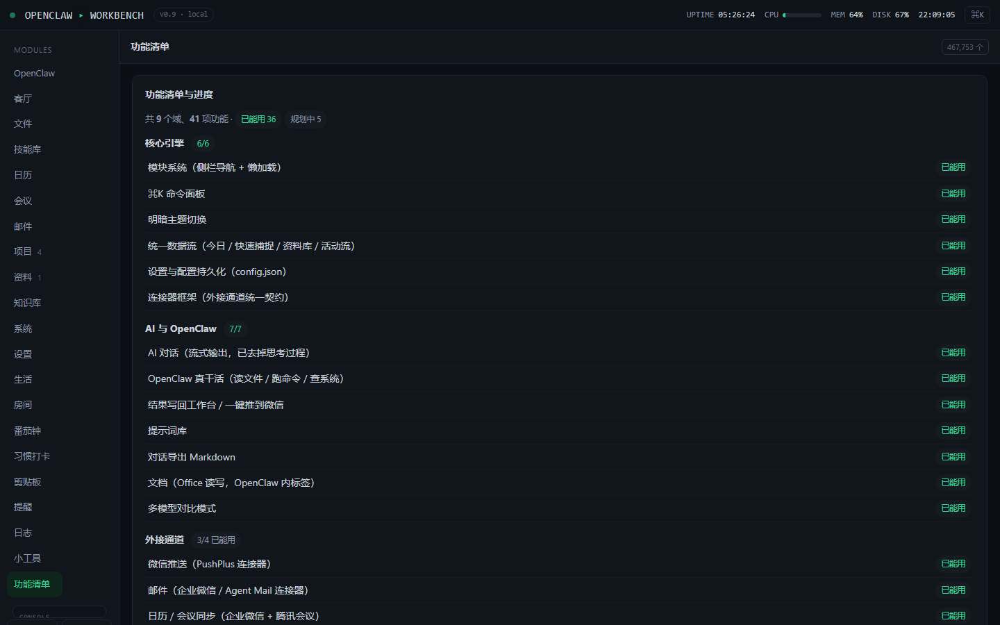
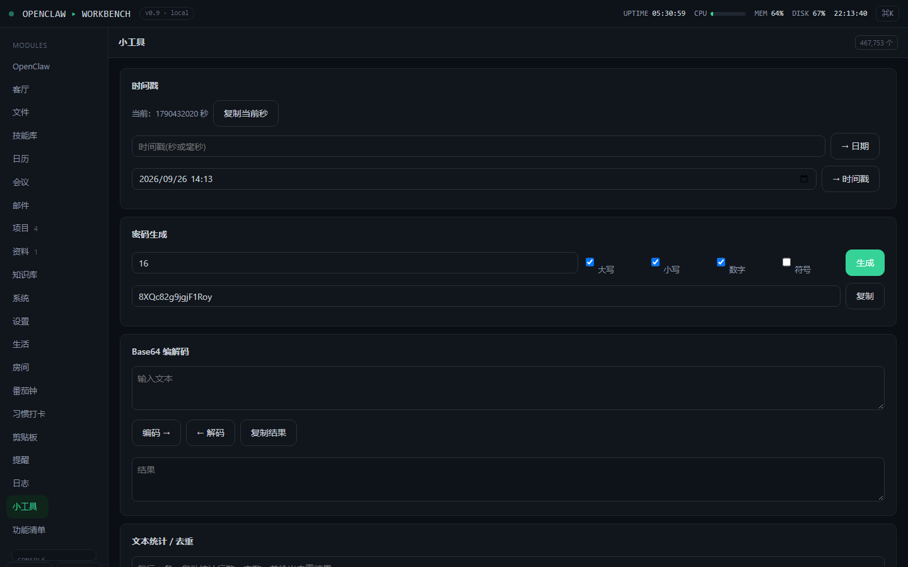

# OpenWorkbench

**[English](README.en.md)**

**让 AI 主动来找你，而不是你一直去问它。**

早上你还没看手机，它已经把今天要紧的邮件挑出来放好了 —— 需要你回的那几封，
回复草稿写好了等你点确认。你在微信里发一句「把这个打出来」，纸就出来了。
手机拍的照片，电脑上直接就有。

它把你**本机**的 Ollama、OpenClaw、文件、终端、邮件、打印机接进一个界面，
**零第三方依赖**（只用 Python 标准库，`pip install` 什么都不用装），数据全程不出你的机器。

```bash
git clone https://github.com/ZhangZhangooo/open-workbench
cd open-workbench
python server.py 8777        # → http://127.0.0.1:8777
```

**Windows 直接双击 `start.bat` 就行**（自动起服务 + 开浏览器 + 崩溃自动重启）。

需要 Ollama / OpenClaw 的话有一键脚本，但**那一步可以晚点做** ——
先把界面跑起来看看，模型的事不着急。

<details>
<summary><b>不想自己装 Ollama / OpenClaw？</b>（点开看一键脚本）</summary>

| 系统 | 命令 |
| --- | --- |
| Windows | `powershell -ExecutionPolicy Bypass -File install.ps1` |
| macOS / Linux | `sudo ./install.sh` |

脚本会：装/起 Ollama → 拉对话模型 `gpt-oss:120b-cloud` 和看图模型 `gemma4:31b-cloud`
→ 装 OpenClaw → 生成 `config.json` 指向你本机的 Ollama。
默认每一步都把命令打出来等你按回车；加 `-Yes` / `--yes` 就全自动。

**绝不覆盖你已有的 `config.json`** —— 先备份成 `config.json.bak.<时间戳>`，
且只在「没配过」或「还是出厂默认值」时才改。

> 那两个模型是 Ollama **云端**模型，只有几百字节的代理壳、不下权重，拉起来是秒级的。
> 想跑纯离线本地模型，自己 `ollama pull qwen2.5:7b` 之类即可。

**macOS / Linux 必须在项目目录下执行，且必须带 `./`**（当前目录 `.` 不在 `$PATH` 里，
直接敲 `install.sh` 会报 `command not found`）：

```bash
sudo ./install.sh               # 推荐：整体以 root 跑，脚本内部会把 brew/ollama 降回你本人
chmod +x ./install.sh && sudo ./install.sh   # 想用 ./ 这种写法就先赋一次执行权
```

**为什么整个脚本 sudo、而不是只在某几步 sudo**：mac 上装 Ollama / Node / OpenClaw 几乎每步都要权限，
整体 sudo 一次最省事。但 `brew` 与 `ollama` 必须降回你本人执行 ——

- **brew 直接拒绝以 root 运行**（`Running Homebrew as root is extremely dangerous`），脚本用 `sudo -u <你> brew …` 代你跑；
- **ollama 的模型要落在你自己的家目录**，以 root 跑 `ollama pull` 会下进 `/root/.ollama`，
  你日常跑的 ollama 反而看不到、也写不进。

脚本的正确姿势是：**以 root 运行整个脚本，brew / ollama / openclaw / npm 全部以你的身份执行；
只有 `apt`、官方 Ollama 安装脚本写 `/usr/local`、以及收尾 chown 才用 root**，
而且默认会先把每条命令打出来等你按回车。脚本是 root，所以生成的 `config.json`、`data/`、
`~/.ollama` 会先归 root，收尾时**还给你自己**。

**OpenClaw 是特例**：Homebrew 里的 openclaw 是 **cask**（只装 `/Applications/OpenClaw.app`，
不含命令行），而工作台要连 gateway 必须有 CLI。所以脚本在装完客户端后还会继续装命令行，
优先走官方脚本 `curl -fsSL https://openclaw.ai/install.sh | bash`，不行才
`npm install -g openclaw@latest --allow-scripts=openclaw`。最后用
`ollama launch openclaw --model gpt-oss:120b-cloud -y` 把它拉起来 ——
这一步**不接入任何渠道**，想接的话自己跑 `openclaw onboard`。

这步通常要 **1~3 分钟**，中间屏幕可能长时间只有一条进度条 —— 那不是卡住。
超过 5 分钟完全没动静，多半是 npm 源慢，可以先 `npm config set registry https://registry.npmmirror.com` 再重跑。

**Windows 报「文件未经数字签名」**：下载的 `.ps1` 会带「来自 Internet」标记被拦，三种解法任选：
① 用上面带 `-ExecutionPolicy Bypass` 的命令；② 先 `Unblock-File install.ps1` 再跑；
③ 把 `install.ps1` **存到本机盘**（如 D 盘）再跑 —— 本地盘不带这个标记。

</details>

## 长什么样

| 客厅仪表盘 | 项目看板 |
| --- | --- |
|  |  |

| 功能全景 | 小工具 |
| --- | --- |
|  |  |

> 截图是干净的本地实例，不含任何个人信息。

---

## 它能替你干什么

| 你说 | 它做 |
| --- | --- |
| 早上还没看手机 | 定时挑出今天要紧的邮件、写好需要回的草稿，等你点确认 |
| 在微信里发「把附件打出来」 | 唤起打印，纸就出来了（打印机自动发现，`/api/print/*`） |
| 在手机上传一张照片 | 电脑收件箱里立刻就有，**原图直传不重编码**（EXIF 完整） |
| 「这周还有啥没做完」 | 读今日待办，逐条说下一步 |
| 「把这个存起来」 | 写进知识库 / 随手记 / 项目，都走待审队列，你点确认才落库 |

---

## 快速开始（Ollama / OpenClaw 已就绪）

```bash
python server.py 8777
# 浏览器打开 http://127.0.0.1:8777
```

Windows 直接**双击 `start.bat`**（自动起服务 + 开浏览器 + 崩溃自动重启，
启动前会精准清掉残留实例，不会像手点那样留着旧进程占着端口）。
配置按需填，模板见 `config.example.json`。

## 特性

**跑起来很轻**

- **零第三方依赖**：只用 Python 标准库，**没有 requirements.txt**，`pip install` 什么都不用装。
- **前端后端一体**：`server.py` 既托管 `static/` 前端，又处理 `/api/*` 后端。
- **真终端**：内置 ConPTY（Windows），不是网页里仿的那种假 shell。
- **数据在自己机器**：落在 `data/app.db`，可导出备份。

**它替你干活，不只是等你问**

- **定时自动化**：早间邮件简报、今日回顾、每周回顾等任务，用 OpenClaw 自己的 cron 排期。
- **MCP 标准接口**：`wb_mcp.py` 把「读邮件 / 加待办 / 存资料 / 查状态」注册成 MCP 工具，
  `openclaw mcp add` 一挂，**OpenClaw 直接调工具**，不是照着提示词猜 URL。
- **微信双向**：企业微信自建应用 + 「微信插件」，让你在**普通微信**的聊天框里直接指挥它 ——
  发一句话，它干活，结果发回同一个框。官方合规通道，不碰逆向协议。
- **连接器框架**：PushPlus / Server酱 / 企业微信 / Webhook / SMTP，结果能推到微信、邮箱、任意 HTTP 端点。

**你手上有的东西都能接进来**

- **25 个可配置模块**：今日 / 任务 / 文件 / OpenClaw / 技能库 / 日历 / 会议 / 邮件 / 项目 / 笔记 /
  资料库 / 系统 / 设置 / 生活 / 房间 / 番茄钟 / 习惯 / 剪贴板 / 提醒 / 日志 / 小工具 /
  系统工具 / 功能清单 / **互传** / **打印机**。每个都能单独开关、改名、调顺序。
- **问一问**：接 Ollama 兼容接口的多模型对话，支持多模型对比、自动剥离推理模型的思考过程。
- **打印**：普通打印机自动发现（Windows 队列 + IPP/IPPS 直连双通道），3D 打印机支持
  **OctoPrint / Klipper-Moonraker / PrusaLink 三协议** + 局域网自动扫描，能看进度温度、能暂停取消。
- **文件索引**：几十万份本地文件的秒搜 + 正文搜索（离线也能搜）。

**手机 / 平板真能用**

- **设备间互传文件**：手机拍照直接传到电脑，**原始字节直传不重编码**（EXIF 完整保留，
  比截图/粘贴强得多）；有配额和过期清理。
- **移动端外壳**：窄屏自动变抽屉 + 底部导航 + 左滑关闭。
- **可安装 PWA**：装到桌面全屏无地址栏（`manifest` + Service Worker，network-first 所以改了立刻生效）。
- **终端手机可用化**：21 键触控键帽行（44px 好点）、常用命令条、字号可调（手机与桌面各记一份，互不污染）。
- **局域网直连**：手机连本机，可设口令也可关闸免密。

**中英双语**

- 界面语言**默认跟随系统**，顶栏 `ZH / EN` 一键切（也支持 `Ctrl+L` 和命令面板）。
- 没翻译到的部分保持中文、不会变空白；语言包随项目一起走。

## 在微信里指挥它（企业微信双向通道）

普通微信没有官方的消息接口，硬接会封号。这里走的是官方合规的路子，配好之后体验跟普通微信没区别。

**为什么是企业微信**：企业微信有「我的企业 → 微信插件」。个人微信扫一下插件二维码，
之后收发消息都落在**你自己的微信**里。**同一个手机号就行**，不用第二个微信号，也不用营业执照。

一次性准备（约 5 分钟，在企业微信后台做）：

1. 手机号注册企业微信，进管理后台；
2. 「我的企业 → 企业信息」抄下 **企业ID**；
3. 「应用管理 → 自建 → 创建应用」拿到 **AgentId** 和 **Secret**；
4. 「我的企业 → 微信插件」生成二维码，用你自己的微信扫；
5. 插件页里「仅在企业微信中接收消息」**取消勾选**，否则微信里收不到。

然后在工作台的「设置 → 企业微信」面板里：

- 填上面那几样，点「随机生成 Token + AESKey」再保存；
- 点「开隧道」拿到一个 `https://xxx.trycloudflare.com/wecom/callback`（家里宽带没公网 IP 也能用，
  靠 [cloudflared](https://github.com/cloudflare/cloudflared) 的临时隧道），把它连同 Token、AESKey 填进后台的「接收消息」；
- 点「连通性自检」，最后一步会真发一条消息到你微信。

配好之后，在微信里这么说：

| 说 | 效果 |
| --- | --- |
| `帮助` | 看命令表 |
| `今日` | 今天还剩什么事没做 |
| `记 买牛奶` | 攒进收件箱 |
| `待办 交电费` | 直接进今天 |
| `账 32 吃饭` / `账 收入 500 稿费` | 记一笔流水（超支会顺带提醒） |
| `搜 报销单` | 在几万到几十万份本地文件里找 |
| 其它任何话 | 原样交给本机 OpenClaw 干活，干完把结果发回这个聊天框 |

两个必须知道的坑：

- **回调地址是临时的**：quick tunnel 重开就换地址，得回后台改一次。想稳定就用自有域名 + 命名隧道。
- **家庭宽带是动态 IP**：本机公网 IP 一变，企业微信发消息会报 `60020`。IP 要填进后台的
  「企业可信IP」；工作台发现 IP 变了会在「系统 → 日志」里提醒你。

## 平台差异（先说清楚）

| | Windows | macOS / Linux |
| --- | --- | --- |
| 主体功能（问一问、OpenClaw、文件、项目、日历、邮件…） | ✅ | ✅ |
| 内置终端（基于 ConPTY，需 Win10 1809+） | ✅ | ❌ |
| WPS 文档读写集成 | ✅ | ❌ |

## 远程访问（自托管）

想用手机 / 外网访问你**自己本机**的能力：

1. 在 `config.json` 的 `remote` 段设：
   ```json
   "remote": { "bind": "0.0.0.0", "gate": true, "allow_lan": true, "token": "一段强随机串" }
   ```
   - `gate: false` = 关闸：同一网段（手机、平板）**免密直进**，连终端接口也一并开放；
   - `gate: true` = 开闸：非本机必须带口令（`?k=` 换 cookie），**且终端类接口只认本机**。
2. 启动：`python server.py 8777`（`bind` 走配置，不用命令行参数）
3. 内网穿透（示例，免费免账号）：`cloudflared tunnel --url http://127.0.0.1:8777`
4. 手机开隧道地址即可。

> ⚠️ 安全：**不要裸绑 `0.0.0.0` 又关闸**，那等于把你的文件索引和终端暴露给同网段任何人。
> 要长期开着建议 `gate: true` + 强随机 `token`。终端接口（`/api/term`、`/api/bridge`）
> 无论开关闸都只认本机 —— 手机端终端只在关闸模式下可用，开闸后会收到中文说明而不是直接报错。

> 另注：把它部署成**纯静态站点**（没有本机后端）时，问一问 / OpenClaw / 文件 / 终端 / 系统
> 这些依赖本机的能力不可用 —— 那只是个前端壳，界面会明确提示而不是白屏。

## 开源回环

这是一个开放的产品：每个使用者跑自己的实例、连自己本机的 openclaw/ollama、各自做内网穿透。
**欢迎把你的技能、配置、部署经验回流到本仓库**，形成生态循环 —— 怎么回流见 [CONTRIBUTING.md](CONTRIBUTING.md)。

## 安全说明

`config.json` 含真实凭据（邮箱密码、AI key），已被 `.gitignore` 排除，**不会**进仓库。
请基于 `config.example.json` 自行创建。源码本身不含任何个人身份信息。

## License

[MIT](LICENSE)
